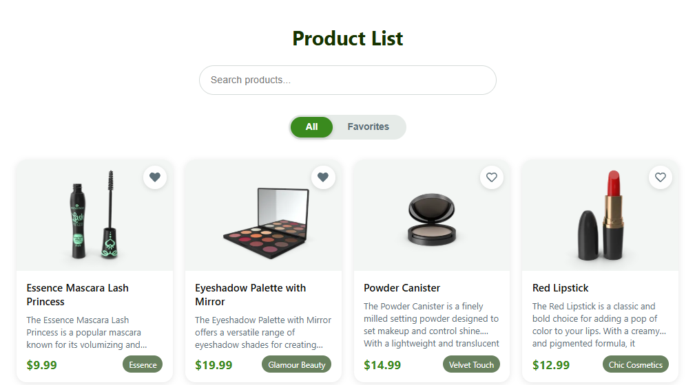

# Product List (React Tutorial)

A small React + Vite app that lists products from the DummyJSON API, with debounced search and a favorites filter. It is a learning project for React fundamentals.



## Features

- Lists the first 10 products from the API as cards (image, title, description, price, brand).
- Search by product name. The request is sent 500 ms after the user stops typing.
- Add or remove a product from favorites with the heart button on each card.
- **All / Favorites** toggle to show either the full list or only the favorited products.
- "No favorites yet" message when the Favorites view is empty.
- Loading and error messages for API requests.
- Responsive card grid.

Favorites are kept in component state only, so they reset when the page is refreshed.

## Tech Stack

- [React](https://react.dev/) 19
- [Vite](https://vite.dev/) 8 with `@vitejs/plugin-react`
- [Axios](https://axios-http.com/) for HTTP requests
- [React Icons](https://react-icons.github.io/react-icons/) (Font Awesome set)
- Plain CSS (one file per feature)
- ESLint with the React Hooks and React Refresh plugins

## Data Source

Product data comes from the free [DummyJSON](https://dummyjson.com) API:

- `GET /products?limit=10`
- `GET /products/search?q=<term>`

## Getting Started

```bash
# 1. Clone the repository
git clone <your-repo-url>
cd react-tutorial

# 2. Install dependencies
npm install

# 3. Create a .env file in the project root
#    VITE_DUMMY_URL=https://dummyjson.com

# 4. Start the dev server
npm run dev
```

Restart the dev server after changing `.env`, because Vite only reads it on startup.

Other scripts: `npm run build`, `npm run preview`, `npm run lint`.

`App.jsx` currently renders only the product list. The currency converter and todo components are earlier practice projects kept in the repo.

## What I Learned

- Fetching data with Axios inside `async` functions and `useEffect`.
- Managing `loading` and `error` state around requests.
- Debouncing a search input with `setTimeout` and the `useEffect` cleanup function.
- Lifting state up: the `favorites` array lives in `ProductList` and reaches each card through props and a callback.
- Deriving a filtered list during render instead of storing it in state.
- Updating arrays immutably (`filter` and spread) instead of mutating them.
- Reading environment variables in Vite with `import.meta.env`.

## Next Steps

- Persist favorites (for example in `localStorage`).
- Clear the error message after a successful request.
- Add a router and mount the currency converter and todo projects as separate pages.
- Add pagination or a "load more" option instead of a fixed limit of 10.
